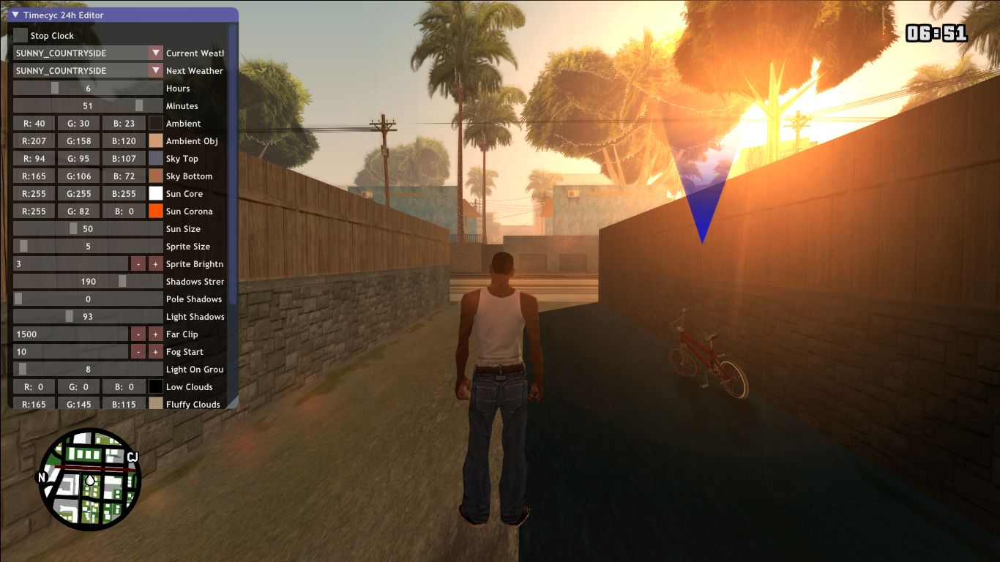

# In-game TimeCycle Editor



An ImGui panel that runs inside GTA: San Andreas, edits the game's live `CTimeCycle` array while you look at the scene, and writes the result back out as a drop-in `timecyc.dat`.

**Released:** June 2018 on GTAForums · **Updated:** 2019 · **Platform:** GTA: San Andreas v1.0 (PC) · **Runtime:** MoonLoader + MoonImGui

## What it does

San Andreas keeps all of its lighting and atmosphere tuning — ambient colour, sky gradient top and bottom, sun core and corona, sun and sprite size, fog start, far clip, water colour and alpha, two post-processing passes, cloud alpha, directional multiplier — in a flat array called `CTimeCycle`.

Normally you edit that array as `timecyc.dat`, a large whitespace-delimited text file, and restart the game after every change. This script exposes twenty-four of those values as colour pickers and sliders over the running game, so you tune lighting against the actual scene, then serialise the array back into a correctly formatted `.dat`. It can also drive the camera from inside the panel, so you can look at the sky you're editing without alt-tabbing or starting a separate debug camera.

## How it works

**Reaching the array.** `CTimeCycle` is not a symbol in the executable — each field is reached through its own pointer, read out of a hardcoded address and cast to a typed buffer:

```lua
m_nAmbientRed = ffi.cast("unsigned char*", memory.getuint32(0x55F4D6))
m_fFarClip    = ffi.cast("short*",         memory.getuint32(0x55F61B))
```

Every field is an array indexed `23 * hourIndex + weatherId` — `23` being the number of weather IDs, `hourIndex` the time-of-day keyframe. That single stride is why changing time or weather immediately reads the right slot.

**Eight-hour and twenty-four-hour timecycles.** Vanilla stores eight keyframes per weather; the `timecycle24.asi` plugin extends that to twenty-four. The script probes for that module at startup with `getModuleHandle`, switches `NUMHOURS`, and maps wall-clock hour onto the keyframe index accordingly:

```lua
if h < 5 then id = 0 end
if h == 5 then id = 1 end
if h == 6 then id = 2 end
if 7 <= h and h < 12 then id = 3 end
-- ...
```

So one build edits either layout, and the panel title reports which one it detected.

**Driving the camera from inside the panel.** The game reads raw mouse deltas out of `CMouseControllerState`, a struct that lives at a fixed address. Declaring it with `ffi.cdef` and casting the address gives direct write access:

```lua
ffi.cdef[[ struct CMouseControllerState { /* lmb, rmb, ..., float Z, X, Y */ }; ]]
local mouseState = ffi.cast("struct CMouseControllerState*", 0xB73418)
```

Then every frame the panel is open, the right-button drag delta from ImGui is written straight into `mouseState.X` and `mouseState.Y`. ImGui sees the drag because the panel is capturing it; the game sees it because it's reading the same struct — so the camera orbits while you're holding the panel, with no separate camera code at all. `InvertCamXAxis` / `InvertCamYAxis` at the top of the script flip the sign if the controls feel backwards.

**Keeping the player alive while you work.** Opening the panel used to leave the player standing in traffic with control disabled. `MakePlayerSafe` NOPs out the seven-byte instruction at `0x56E89D` that feeds input to the game's control pads, and restores it on close, while `setPlayerControl` handles the script-level half. The "Lock Player Control" checkbox is deliberately separate from "Stop Clock": you often want the world frozen but the camera live, or the reverse.

**Freezing the clock.** Editing lighting is pointless if the sun keeps moving. "Stop Clock" NOPs out the `CClock::Update` call site (five bytes of `0x90`) and pins the time to the sliders; unchecking restores the original instructions. Both this and the control lock are released explicitly when the panel closes, so a stale lock can't survive into normal play.

**Colorcycle.** If SkyGfx is loaded, `SHIFT` calls into its `Colorcycle::Initialise` routine — resolved at `getModuleHandle("skygfx") + 0x13B90` — which regenerates the colour-cycle tables from the edited timecycle without restarting the game.

**The `.dat` writer is the hard part.** `timecyc.dat` is whitespace-delimited with a strict column order, a comment header at midnight and midday, and per-weather section banners. Get one column wrong and the game either refuses the file or produces garbage. `SaveToFile` reproduces all of it — a twenty-five-column header row built from `string.format("%18s")` so the columns line up with the data, `// 7PM`-style time comments, per-weather banners — and applies the engine's own unit conversions: sun size, sprite size, sprite brightness and light-on-ground brightness are stored as bytes representing `(value - 0.5) / 10`, and the directional multiplier is a byte printed as `/ 100.0`, giving the 0.0–2.55 range the UI exposes.

## Requirements

- GTA: San Andreas v1.0 US (tested against the 1.0 builds commonly used by the modding community — the memory addresses are build-specific)
- [MoonLoader](https://blast.hk/moonloader/)
- [MoonImGui](https://blast.hk/threads/19292/)
- *Optional:* [`timecycle24.asi`](https://gtaforums.com/topic/892517-24h-timecycle/) — detected automatically if present
- *Optional:* [SkyGfx](https://gtaforums.com/topic/838271-skygfx/) — only for the `SHIFT` colorcycle reload

## Install

1. Copy `timecyc-editor.lua` into `GTA San Andreas/moonloader/` — **not** the `lib` folder.
2. Launch the game.
3. Press **CTRL + T** to open the panel.

## Usage

- **CTRL + T** toggles the panel.
- **Hold right mouse and drag** to move the camera while the panel is open.
- **SHIFT** re-initialises the colorcycle (requires SkyGfx).
- **Stop Clock** freezes time of day; **Lock Player Control** freezes the player. Both are released when the panel closes.
- Weather dropdowns force current and next weather, so you can stage a transition and tune both sides of it.
- **Save Timecyc** writes `timecyc_24h.dat` into `moonloader/` — the filename is set by `timecycFilename` at the top of the script. Autosave writes `timecyc_bak.dat` every five minutes while the panel is open.
- **Reset Timecyc** calls the game's own `CTimeCycle::Initialise` to restore defaults.

## Known issues and things I'd change

- `imgui.Combo(..., #weather)` (lines 245 and 249) — `weather` is a 0-indexed table, and the length operator is undefined for that. In practice it returns 22, so `EXTRACOLOURS_2` can't be selected from the dropdown. Should be an explicit constant.
- `io.open` (line 442) isn't checked before writing. If the working directory isn't writable, saving crashes instead of reporting an error.
- **`SHIFT` without SkyGfx crashes.** If `skygfx.asi` isn't loaded, `Colorcycle` is set to `nil` (line 164) but the key handler calls `Colorcycle.Initialise()` unconditionally (lines 175–178), so the first press indexes nil. A `if bColorcycle then` guard is missing.
- **`bColorcycle` is inverted and unused.** The `else` branch sets it to `true` when SkyGfx is *absent* (line 163), and nothing ever reads it — it was clearly meant to be the guard above.
- **The default window is too narrow at 16:9.** `Window.SizeX` is scaled by `sx/648`, but the label column shrinks with it — at 1366×768 labels like "Current Weather" and "Sprite Brightness" are clipped, which you can see in the screenshot above. The window is resizable, so it's cosmetic, but a truncated UI is the first thing a new user sees.
- **Dead code left behind by the rewrite.** `CPlayerData_bCanBeDamaged` (line 541) was superseded by `MakePlayerSafe` and is never called; `getSpaces` (line 583) is unused now that the writer uses `%18s`; `Im.ProcessColorcycleData` (line 419) is empty; the `Colorcycle` table is commented out.
- Globals (`bEnable`, `timecycFilename`, `Window`, `InvertCamXAxis`, `bTimecyc24h`) leak into MoonLoader's shared environment rather than being local to the script.
- **The big one:** forty-nine separate hand-cast pointers is the wrong data model. The script already proves the alternative works — `CMouseControllerState` is a single `ffi.cdef` and one cast — so declaring `CTimeCycle` the same way would remove every address constant, make the `23 * hour + weather` stride explicit, and let one function write both memory and the file.

## Links

- [GTAForums release thread](https://gtaforums.com/topic/910061-in-game-24h-timecycle-editor/)
- [`timecycle24.asi`](https://gtaforums.com/topic/892517-24h-timecycle/) — the plugin that enables 24-hour timecycles in the first place
